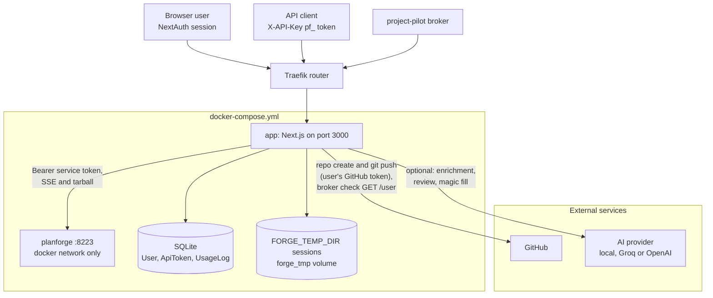
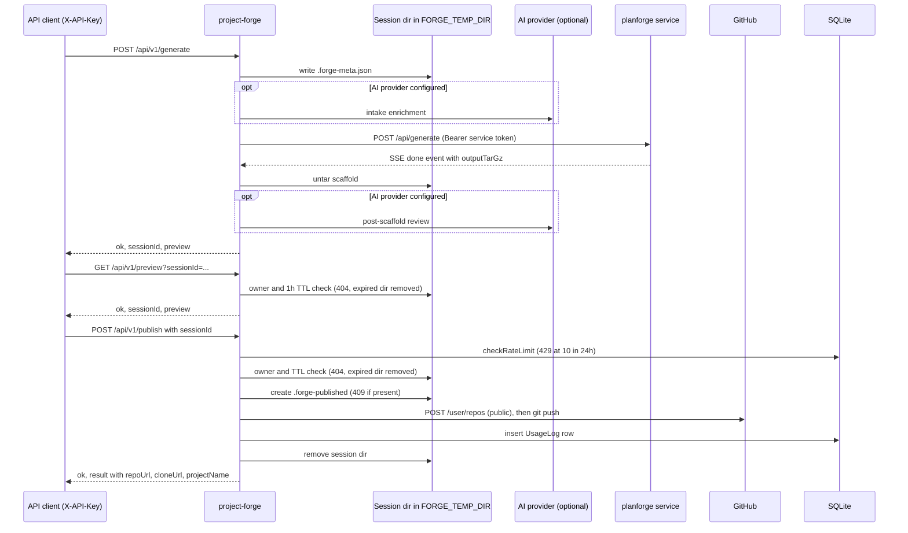

# Architecture: project-forge

## Overview

project-forge is a full-stack web application built with **Next.js 15** (App
Router) and **TypeScript**. Users describe a project in a form, the server asks
the **agent-planforge HTTP service** to plan and scaffold it (planforge runs
both the planforge CLI and scaffoldkit in its own container, see
[ADR-0002](adrs/0002-tool-decoupling-service-boundary.md)), the result is
extracted into a temporary directory, previewed, and on confirmation pushed to a
new GitHub repository.

The same capabilities are exposed as a token-authenticated REST API under
`app/api/v1/` so agents can drive generation programmatically.

The diagram below shows the deployed components: Traefik as the only ingress,
the `app` container with its SQLite database and session volume, the
internal-only planforge service, and the external services `app` calls.



## Principles

1. **Code is the source of truth**: behaviour lives in the route handlers and
   `lib/` modules; docs track the code, not the other way round.
2. **Thin UI, server-side orchestration**: pages collect input and render
   previews; planning, scaffolding, and GitHub push happen in server route
   handlers.
3. **One toolchain boundary**: project-forge reaches planforge and scaffoldkit
   only through the planforge HTTP service. scaffoldkit is an implementation
   detail behind it and is never invoked from this app.
4. **No secrets in responses or logs**: internal error detail (file paths,
   stderr, PATs) is sanitized before it reaches clients or logs.
5. **Dark-only UI**: Tailwind, dark-first, no light mode.

## System Structure

```
project-forge/
├── app/                          # Next.js App Router
│   ├── (dashboard)/              # Auth-protected pages
│   │   ├── create/page.tsx       # Project creation form
│   │   ├── dashboard/page.tsx    # User dashboard
│   │   ├── login/page.tsx        # Login
│   │   └── settings/page.tsx     # User settings / API tokens
│   ├── api/                      # Route handlers
│   │   ├── v1/                   # Public REST API (X-API-Key auth)
│   │   │   ├── generate/route.ts # Plan + scaffold, return a sessionId
│   │   │   ├── preview/route.ts  # Read a previously generated session
│   │   │   ├── publish/route.ts  # Create GitHub repo from a session
│   │   │   └── projects/route.ts # GET list / DELETE / POST one-shot create
│   │   ├── auth/                 # NextAuth, email/password sign-up (register/), project-pilot broker
│   │   ├── generate/route.ts     # Web UI generation (session auth)
│   │   ├── publish/route.ts      # Web UI publish (session auth)
│   │   ├── ai-assist/route.ts    # AI form enrichment ("magic fill")
│   │   └── dashboard/            # profile (route.ts), API tokens (tokens/), GitHub PAT (pat/)
│   ├── docs/page.tsx             # Swagger UI over public/openapi.json
│   ├── styleguide/page.tsx       # UI primitives showcase
│   ├── layout.tsx                # Root layout
│   └── globals.css               # Global styles + Swagger dark overrides
│
├── components/                   # React components (ProjectForm, PreviewPanel, modals, AppShell)
├── lib/                          # Server-side business logic (see below)
├── prisma/schema.prisma          # SQLite schema (users, API tokens, usage log)
├── middleware.ts                 # X-API-Key presence check on /api/v1, login redirect for pages
├── public/openapi.json           # OpenAPI spec served at /docs
└── tests/                        # Vitest integration + unit tests
```

## Key Subsystems

### 1. Routing and API surface

Route handlers under `app/api/` export HTTP-method functions (`GET`, `POST`,
`DELETE`) and return `NextResponse.json()` with explicit status codes.

- **Public REST API** lives under `app/api/v1/` and authenticates with an
  `X-API-Key` header carrying a dashboard-issued `pf_*` token
  (`validateApiToken` in `lib/db.ts`).
- **Web UI routes** (`app/api/generate`, `app/api/publish`, `app/api/dashboard`,
  `app/api/ai-assist`) use NextAuth session auth (email/password credentials
  plus GitHub OAuth, see `lib/auth.ts`).
- `middleware.ts` gates the protected surfaces.

Error responses follow the shape `{ ok: false, error: string, details?: string }`.

### 2. Generate / preview / publish flow

The v1 API is session-oriented and the steps share a single `sessionId` (a
UUID):

1. `POST /api/v1/generate` builds a planforge input
   (`lib/planforge-orchestrator.ts`), calls the planforge service over HTTP
   (`lib/planforge-client.ts`), extracts the returned tarball into
   `${FORGE_TEMP_DIR}/<sessionId>`, runs a post-scaffold review
   (`lib/post-scaffold-review.ts`), and returns `{ ok, sessionId, preview }`.
2. `GET /api/v1/preview?sessionId=<uuid>` re-reads the same temp dir and returns
   the preview (`lib/v1-shared.ts`).
3. `POST /api/v1/publish` (body `{ sessionId }`) creates a public GitHub repo
   with the user's stored GitHub credential and pushes the scaffold (see
   [GitHub publishing](api.md#github-publishing)).

A session is valid for one hour after generation (`SESSION_TTL_MS` in
`lib/v1-shared.ts`); the temp dir is the only session state. Expiry is checked
when a session is read; an expired session dir is removed then, and a published
one right after the push. There is no background cleanup, so sessions that are
never previewed or published stay in `FORGE_TEMP_DIR` (the `forge_tmp` volume
under compose), together with any uploaded documents (see
[deployment.md](deployment.md#session-cleanup)). `POST /api/v1/projects` is a
one-shot variant that does generate plus publish in a single call without a
preview step.

The sequence below shows the v1 session lifecycle, including the order of the
quota, session and publish-lock checks behind the 429, 404 and 409 responses.



### 3. The planforge boundary

`lib/planforge-client.ts` is the only integration with the planning and
scaffolding toolchain. It POSTs to
`${PLANFORGE_URL}/api/generate` with a `Bearer ${PLANFORGE_SERVICE_TOKEN}`
header, consumes an SSE stream, and untars the base64 gzipped result into the
request temp dir. The planforge container runs scaffoldkit internally; this app
ships no Python and no scaffoldkit venv (see the Dockerfile and ADR-0002).
`lib/planforge-output.ts` then resolves the scaffolded artifacts via the
generated `planforge-index.json` when present, falling back to legacy root
paths for older planforge installations that do not emit one.

The other outbound calls are the GitHub REST API and `git push` (publish
routes, and `lib/github.ts` for the broker check) and the optional AI provider
(`lib/ai-provider.ts`).

### 4. Config loading

Configuration is environment-variable based (no config file). Values are read
directly from `process.env` at the point of use, for example `PLANFORGE_URL`,
`PLANFORGE_SERVICE_TOKEN`, `FORGE_TEMP_DIR`, `DATABASE_URL`, `NEXTAUTH_SECRET`,
the optional AI-provider keys, and the optional `ALLOWED_GITHUB_LOGINS`
allowlist. See [configuration.md](configuration.md) for the full list and which are
required.

### 5. Persistence

Prisma over **SQLite** (`prisma/schema.prisma`, `provider = "sqlite"`). The
client is a cached singleton in `lib/db.ts`. The schema syncs via
`npx prisma db push` (there is no `prisma/migrations` directory). Core models:
`User`, `ApiToken`, and `UsageLog` (one row per project published through the
v1 API, also the basis for rate limiting).

### 6. Rate limiting

`checkRateLimit(userId)` in `lib/db.ts` counts `UsageLog` rows for the user in
the trailing 24 hours against `RATE_LIMIT_PER_DAY` (10). It is consumed only by
the publish path (`app/api/v1/publish`) and the one-shot
`POST /api/v1/projects`; `generate`, `preview`, and the list/delete endpoints
are unmetered.

### 7. Secret handling

The publish path sanitizes any embedded GitHub PAT (`x-access-token:...@` remote
URLs and bare `gho_/ghp_/ghu_/ghs_/github_pat_` token shapes) before the message
reaches logs or responses. AI provider keys and the planforge service token are
read from env only.

### 8. Authentication surfaces

| Entry point | Credential | Who can use it |
|---|---|---|
| Email/password sign-up (`POST /api/auth/register`) and sign-in | Email and a password of at least 8 characters | Anyone who can reach the instance |
| GitHub sign-in (NextAuth GitHub provider) | GitHub OAuth; the OAuth token is stored as the publish credential | Anyone with a GitHub account, when `GITHUB_ID` and `GITHUB_SECRET` are set |
| Broker registration (`POST /api/auth/register-from-project-pilot`, see [api.md](api.md#broker-registration)) | A GitHub access token, verified against GitHub's `GET /user` | Any GitHub login, or only the logins in `ALLOWED_GITHUB_LOGINS` when it is set |
| v1 API (`/api/v1/*`) | `X-API-Key` header with a `pf_` token, validated by `validateApiToken` | Holders of a token issued in the dashboard or by broker registration |

`ALLOWED_GITHUB_LOGINS` limits only broker registration; sign-up and GitHub
sign-in are open to anyone who can reach the instance.

## CI/CD Architecture

The pipelines run on GitHub Actions in three workflows:

- `ci.yml` (pushes to `main` and `release/*`, PRs to `main`, also called by the
  release workflow) on Node 20:

  1. `npm ci --legacy-peer-deps`
  2. `npx prisma generate`
  3. `npx tsc --noEmit --skipLibCheck` (typecheck)
  4. `npm run lint` (ESLint)
  5. `npm run build` (`next build`)
  6. `npm run test:coverage` (`vitest run --coverage`, with the coverage
     thresholds from `vitest.config.ts`)

- `audit.yml` (PRs and pushes to `main`): npm audit gate. HIGH or CRITICAL
  advisories fail unless an entry in `.github/audit-allowlist.json` (GHSA id,
  reason, review date) covers them; `scripts/audit-gate.mjs` classifies the
  result.
- `release.yml` (tags `v*`): runs `ci.yml`, then creates a GitHub Release whose
  notes are the `CHANGELOG.md` section headed `## [X.Y.Z]` for the tag version.

## Testing Strategy

Test runner: **Vitest** with `happy-dom`. Integration and unit tests live under
`tests/` (`tests/integration/`, `tests/unit/`) and exercise the route handlers
and `lib/` modules directly. Run with `npm test` or `npm run test:watch`;
`npm run test:coverage` also applies CI's coverage thresholds.

## Decisions

See the [ADR log](adrs/) for architectural decisions and their rationale.
